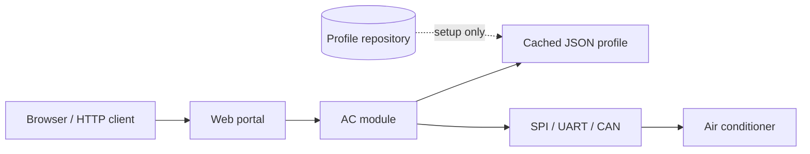

[](LICENSE.md)
[](COMMERCIAL_LICENSE.md)


# OpenComfort

**Local, cloud-free control of your air conditioner, running on an ESP32-S3.**

OpenComfort is open-source firmware that connects to the control bus of an air-conditioner indoor unit and lets you control it from a local web UI or HTTP API. Vendor protocols are described in small JSON **profiles**, so you can add a new model by writing a profile instead of changing the firmware.

> **Status: early development.** Setup, configuration, the web UI, and power, mode, temperature, and fan control work today. Matter support, vane control, and OTA updates are planned. See [Project status](docs/architecture.md#project-status).

## Features

- **Guided setup.** On first boot the device opens a Wi-Fi access point with a setup wizard. No app or account needed.
- **Profile-driven protocols.** A remote manifest lists supported units. The device downloads and caches only the profile it needs, verified with SHA-256.
- **Local web UI and REST API.** Control power, mode, setpoint, and fan speed from a browser, `curl`, or your home-automation system.
- **Pluggable buses.** SPI, UART/RS485, and CAN (TWAI) behind one interface.
- **Works offline.** Bundled fallback profiles let you develop without network access.
- **Modular architecture.** Clean boundaries between modules, buses, and networking make new device types and transports easy to add.

## Supported hardware

| Air conditioner | Bus | Profile |
|---|---|---|
| Mitsubishi Heavy Industries | SPI | [`mitsubishi_heavy_industries`](configs/profiles/mitsubishi_heavy_industries.json) |

Your model isn't listed? [Write a profile](docs/profiles.md#adding-a-new-air-conditioner). Contributions are welcome.

## Quick start

```sh
git clone https://github.com/simply-justin/open-comfort.git
cd open-comfort
. "$IDF_PATH/export.sh"
idf.py set-target esp32s3
idf.py menuconfig        # select the custom partition table (partitions.csv)
idf.py -p /dev/ttyUSB0 flash monitor
```

Then join the `OpenComfort-Setup` Wi-Fi network and open <http://192.168.4.1>.

For the full walkthrough, including the required `menuconfig` settings and hardware safety notes, read **[Getting Started](docs/getting-started.md)**.

## Documentation

| Guide | What's inside |
|---|---|
| [Getting Started](docs/getting-started.md) | Install, build, flash, first-time setup, troubleshooting |
| [Architecture](docs/architecture.md) | Boot flow, modules, buses, storage layout, extension points |
| [Configuration](docs/configuration.md) | Setup flow, bus settings, `config.json` reference |
| [AC Profiles](docs/profiles.md) | Manifest and profile format, command encoding, adding a new unit |
| [HTTP API](docs/http-api.md) | Every endpoint, with examples |
| [Security](SECURITY.md) | Known limitations and how to report vulnerabilities |
| [Contributing](CONTRIBUTING.md) | Development workflow and contribution terms |

## How it works



For details, see [Architecture](docs/architecture.md).

## Contributing

Bug reports, new profiles, and pull requests are welcome. Please read [CONTRIBUTING.md](CONTRIBUTING.md) first. It explains the development workflow and the contribution licence terms.

## License

OpenComfort is free for **personal, educational, and non-commercial use** under the terms in [LICENSE.md](LICENSE.md).

**Commercial use** requires a separate licence. This includes embedding the firmware in products, paid services, SaaS platforms, OEM deployments, or managed smart-home systems. See [COMMERCIAL_LICENSE.md](COMMERCIAL_LICENSE.md).

OpenComfort is an independent project. It is not affiliated with or endorsed by any air-conditioner manufacturer. Product names are used only to identify compatible equipment.
