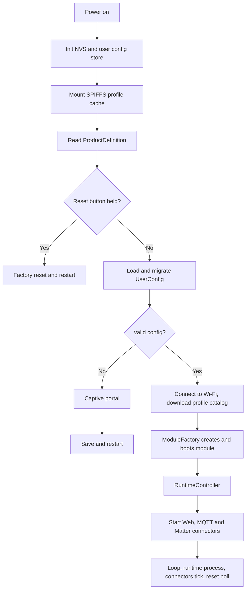
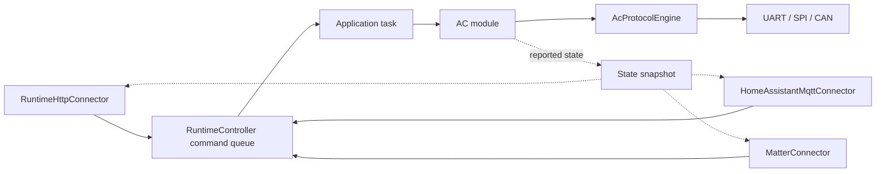

# Architecture

OpenComfort is a single ESP-IDF application in C++ for the ESP32-S3. It splits into a **platform** (setup, Wi-Fi, portal, connectors, updates, storage, schedules, logging) and **modules** that implement a device type behind `IModule`. The AC bridge is the first module. It is built around four rules:

1. **The product is fixed at build time.** Kconfig selects the module, board revision and capability profile. Users never configure pins.
2. **One runtime state, one writer.** Every control surface submits commands to `RuntimeController`. Only the application task touches the bus.
3. **Vendor behaviour lives in profiles.** Frame layouts and command encodings are JSON, not C++, so a module supports new devices without code changes.
4. **Secrets stay out of the user configuration.** Wi-Fi, administrator and MQTT credentials have their own storage.

## Boot sequence

`app_main()` calls `Application::run()` (`main/src/Application/Application.cpp`).

A failed Wi-Fi connection at boot is logged and the device keeps running, so the bus side still works and connectors retry.

## Components

| Area | Location | Responsibility |
|---|---|---|
| Application | `main/src/Application/` | Boot orchestration and the main loop |
| Product | `main/src/Product/` | Immutable product identity, module kind and board definition |
| Config | `main/src/Config/` | Versioned `UserConfig` in NVS (dual-slot commits), connector secrets, factory reset |
| Wi-Fi | `main/src/Wifi/` | SoftAP for setup, station mode, network scan |
| Setup | `main/src/Http/`, `main/src/Setup/` | Captive portal and the per-module setup schema |
| Profiles | `main/src/Profiles/` | Catalog, profile loading, HTTPS download, SHA-256 and ECDSA verification |
| Bus | `main/src/Bus/` | UART, SPI and CAN (TWAI) transports with validation |
| Modules | `main/src/Modules/` | `IModule`, `ModuleFactory`, the AC module and `AcProtocolEngine` |
| Runtime | `main/src/Runtime/` | Canonical desired and reported state, command queue |
| Connectors | `main/src/Connectors/` | Local web portal, Home Assistant MQTT, Matter |
| Schedule | `main/src/Schedule/` | Timed rules and the sleep timer, SNTP and time zone |
| Third-party | `main/src/ThirdParty/` | Nayuki `qrcodegen` (MIT), for the Matter QR code |
| Web assets | `main/www/` | Setup and runtime portal UI and the Geist font (SIL OFL 1.1, `main/www/fonts/OFL.txt`), embedded in the app image so OTA updates include it |
| Profiles | `profiles/` | Source catalog and profiles; published signed on GitHub Pages and cached in SPIFFS on the device |
| Tests | `main/test/` | Unity tests for the runtime and connector manager |

## Runtime and connectors

Connectors only submit bounded commands and read snapshots. They never call a bus driver. `ConnectorManager` starts every connector and keeps the device running when one starts degraded.

## The AC module

On bootstrap the AC module loads the selected profile, checks that the profile's bus is allowed by the product, and opens the transport with the board's pins. A desired-state change runs the profile's `set_power`, `set_mode`, `set_temperature` and `set_fan_speed` commands into a frame of `frameSize` bytes and sends it. Every 2 seconds it polls the profile's `data` requests and updates the reported return-air and set temperatures.

See [AC Profiles](profiles.md) for the profile format.

## Board definition

Pins come from the board definition in `main/src/Product/ProductDefinition.cpp`, never from setup. Rev-A:

| Function | Pins |
|---|---|
| UART | port 1, TX GPIO17, RX GPIO18 |
| SPI | SPI2, SCK GPIO12, MOSI GPIO11, MISO GPIO13, CS GPIO10 for master-mode profiles, max 1 MHz. MHI CNS takes its clock from the unit and uses no CS wire |
| CAN (TWAI) | TX GPIO1, RX GPIO2 |
| Factory reset | GPIO0 (BOOT) |

## Partition layouts

| Profile | File | Layout |
|---|---|---|
| Home Assistant 4 MB | `partitions.csv` | NVS, two 1.5 MB OTA slots, 896 KB SPIFFS |
| Matter / Full 8 MB | `partitions-matter-8mb.csv` | Same partitions as 16 MB, two 2.94 MB OTA slots, 1.9 MB SPIFFS, core dump |
| Matter / Full 16 MB | `partitions-matter-16mb.csv` | NVS, `nvs_keys`, `fctry`, `matter`, two 5 MB OTA slots, 2 MB SPIFFS, core dump |
| Production 4 MB | `partitions-prod.csv` | Legacy layout plus an encrypted `nvs_keys` partition |

Firmware updates go to the inactive OTA slot and must be signed with the release key (see [Firmware signing](runtime-api.md#firmware-signing)). App rollback is enabled: a new image is kept only after it has started Wi-Fi, the module and the connectors (or reached setup); otherwise the bootloader returns to the previous image on the next reset.

## Extending the firmware

| You want to… | Do this |
|---|---|
| Support a new air conditioner | Add a profile to the catalog. See [AC Profiles](profiles.md) |
| Support new hardware | Add a board revision in Kconfig and a `BoardDefinition` in `ProductDefinition.cpp` |
| Add a device type | Add a `ModuleKind`, an `IModule` implementation, a setup provider and a Kconfig module choice |
| Add a control surface | Implement `IConnector` and register it in `Application.cpp` |

Register new source files in `main/CMakeLists.txt`.
