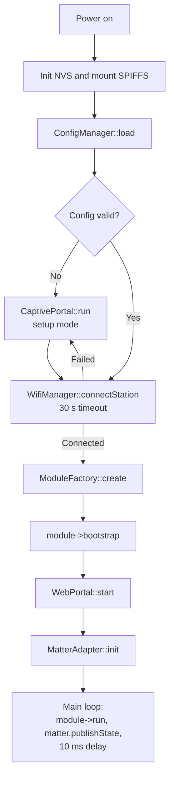
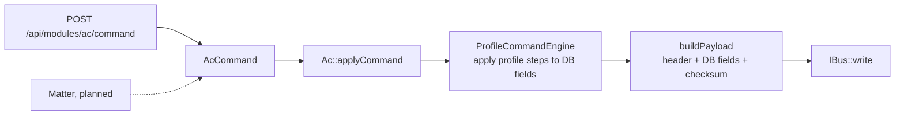

# Architecture

OpenComfort is a single ESP-IDF application written in C++17. It is built around three rules:

1. **Modules own device behaviour.** Networking, HTTP, and Matter code never live inside a module.
2. **Buses own transport.** Modules talk to hardware through the `IBus` interface and never call a driver directly.
3. **Profiles own vendor specifics.** Byte layouts and command encodings live in JSON profiles, not in C++.

With these rules, you can add support for a new air conditioner by writing a profile, without changing the firmware.

## Boot sequence

`app_main()` in `main/main.cpp` is the only entry point.



If any step after setup fails (module creation or bootstrap), the firmware logs an error and stops. It does not retry. Check the serial monitor when a device seems unresponsive.

## Components

| Area | Location | Responsibility |
|---|---|---|
| Entry point | `main/main.cpp` | Boot sequence and main loop |
| Configuration | `main/src/Configs/` | Load, validate, and save `/spiffs/config.json`. Fetch remote manifests and profiles |
| Networking | `main/src/Core/WifiManager.*` | Setup access point and station connection |
| HTTP | `main/src/Http/` | Setup wizard (`CaptivePortal`), runtime API and UI (`WebPortal`), embedded HTML (`HttpPages.hpp`) |
| Modules | `main/src/Modules/` | `IModule` interface, `ModuleFactory`, and the `Ac` module |
| Buses | `main/src/Busses/` | `IBus` interface, `BusFactory`, and `Uart`, `Spi`, `Can` drivers |
| Protocol adapters | `main/src/Protocols/` | `MatterAdapter` (a placeholder for now) |
| Bundled assets | `main/spiffs/` | Fallback manifest and profiles, flashed to the `storage` partition |
| Profile repository | `configs/` | Reference layout for the remote manifest and profile repository |

## Modules

Each module implements `IModule` (`main/src/Modules/IModule.hpp`):

```cpp
class IModule {
public:
    virtual void bootstrap() = 0;     // called once; acquire resources
    virtual bool isBooted() const = 0; // true when bootstrap succeeded
    virtual void run() = 0;           // called every main-loop iteration
};
```

`ModuleFactory` builds the right module from the `ModuleConfig` variant in the device configuration. Today the only module is `Ac`.

### The AC module

On `bootstrap()`, the `Ac` module:

1. Loads the cached profile with `AcProfileLoader`.
2. Checks that the configured bus type matches `profile.protocol.bus`.
3. Creates and initializes the bus with `BusFactory`.

At runtime it keeps an 18-byte DB field buffer (`DB0` to `DB17`) that represents the unit's control frame. A command such as "set mode to cool":



Every 500 loop iterations (about every 5 seconds), `run()` sends a telemetry query from the profile's `data` list and updates `currentTemp` from the reply.

For the profile format and how commands are encoded, see [AC Profiles](profiles.md).

## Buses

`IBus` (`main/src/Busses/IBus.hpp`) has three methods: `init()`, `write()`, and a blocking `read()` with a short timeout. `BusFactory` selects the implementation from the `Bus` variant:

| Config type | Implementation | Notes |
|---|---|---|
| `SpiConfig` | `Spi` | SPI master. The mode comes from the profile (`mode0` to `mode3`) |
| `UartConfig` | `Uart` | Also used for RS485 |
| `CanConfig` | `Can` | ESP32 TWAI peripheral |

## Storage layout

`partitions.csv` defines a 2 MB layout:

| Partition | Type | Offset | Size | Contents |
|---|---|---|---|---|
| `nvs` | data/nvs | `0x9000` | 24 KB | ESP-IDF Wi-Fi and system data |
| `phy_init` | data/phy | `0xF000` | 4 KB | RF calibration |
| `factory` | app | `0x10000` | 1.375 MB | Firmware |
| `storage` | data/spiffs | `0x170000` | 576 KB | Config, manifest, cached profiles |

There is no OTA partition yet, so firmware updates must be flashed over USB.

## Extending the firmware

| You want to… | Do this |
|---|---|
| Support a new air conditioner | Write a profile. See [AC Profiles](profiles.md). No C++ changes are needed if it uses the existing command variables |
| Add a new transport | Implement `IBus`, add its config struct to the `Bus` variant in `Models/Bus.hpp`, handle it in `BusFactory`, and handle it in the bus parse and serialize code in `ConfigManager` and `CaptivePortal` |
| Add a new device type (fan, purifier, …) | Implement `IModule`, add a config struct to the `ModuleConfig` variant, and handle it in `ModuleFactory` and `ConfigManager` |
| Add a new control channel | Translate requests into an `AcCommand` and call `Ac::applyCommand`, the same way `WebPortal` does |

## Project status

| Area | Status |
|---|---|
| Setup portal, config persistence, remote profiles | Working |
| Local web UI and HTTP API | Working |
| Profile command engine (power, mode, temperature, fan) | Working |
| Telemetry | Basic: room temperature only |
| Vanes, 3D auto, error data | Defined in profiles, not yet exposed by the API |
| Matter | Placeholder only. ESP Matter is not integrated yet |
| OTA updates | Not supported |
